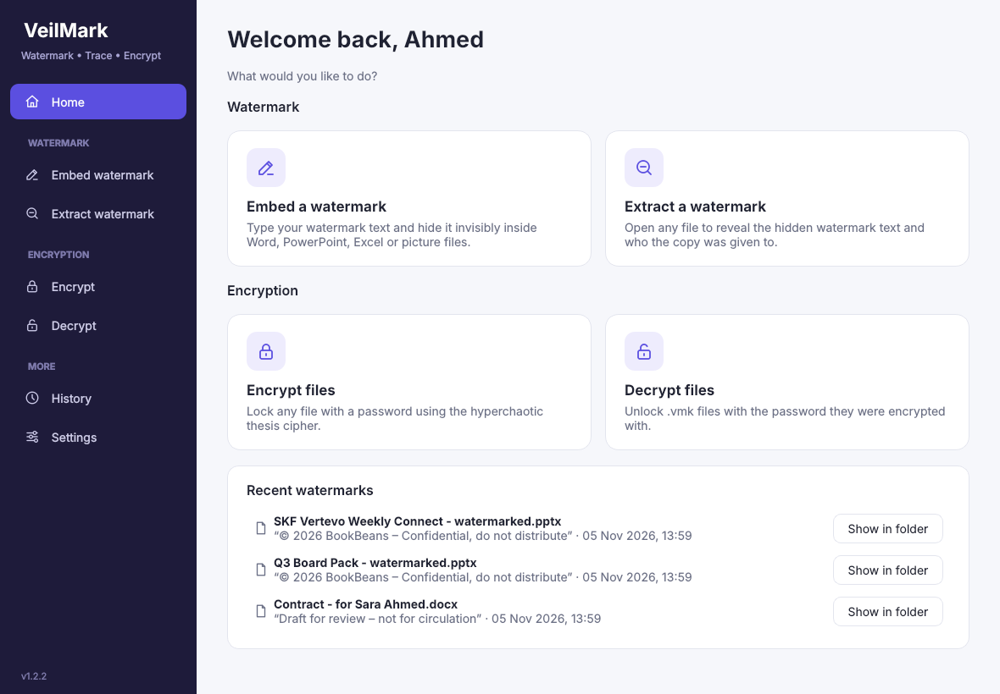
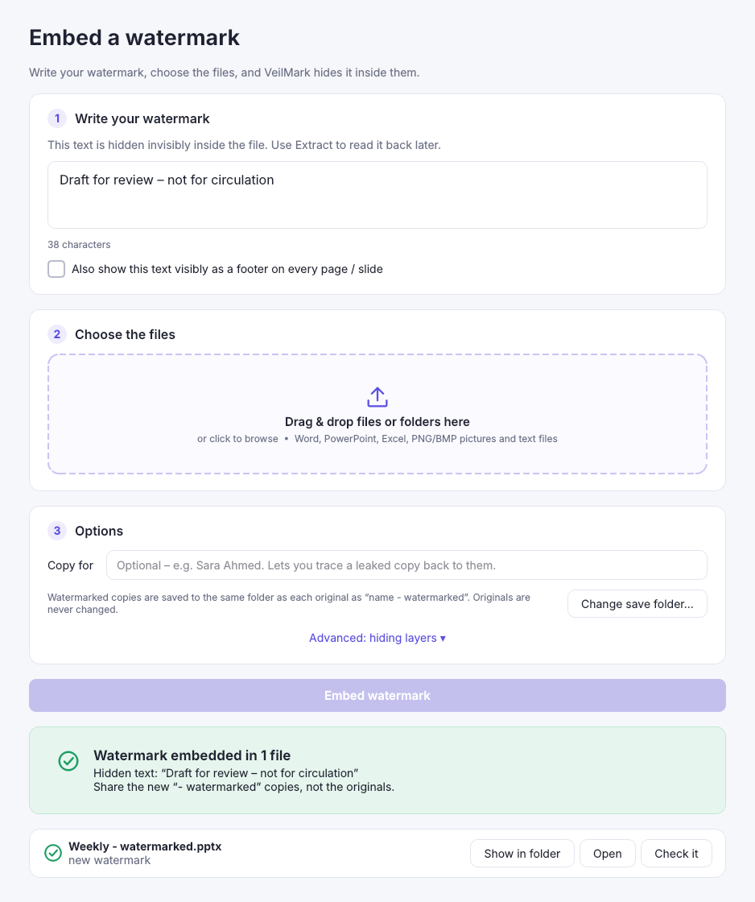
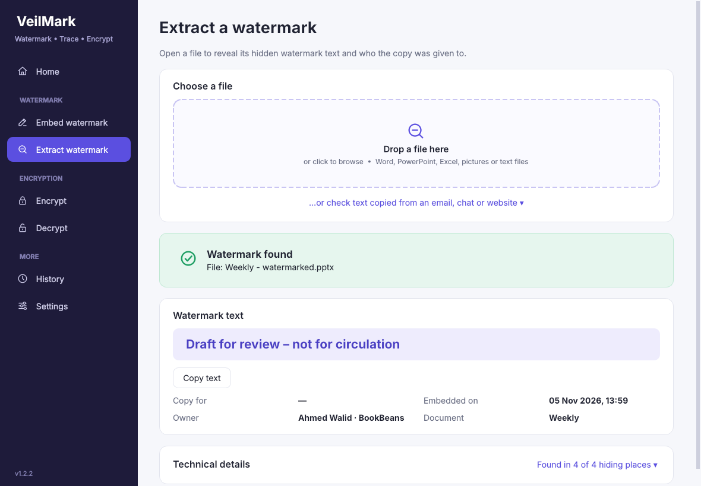
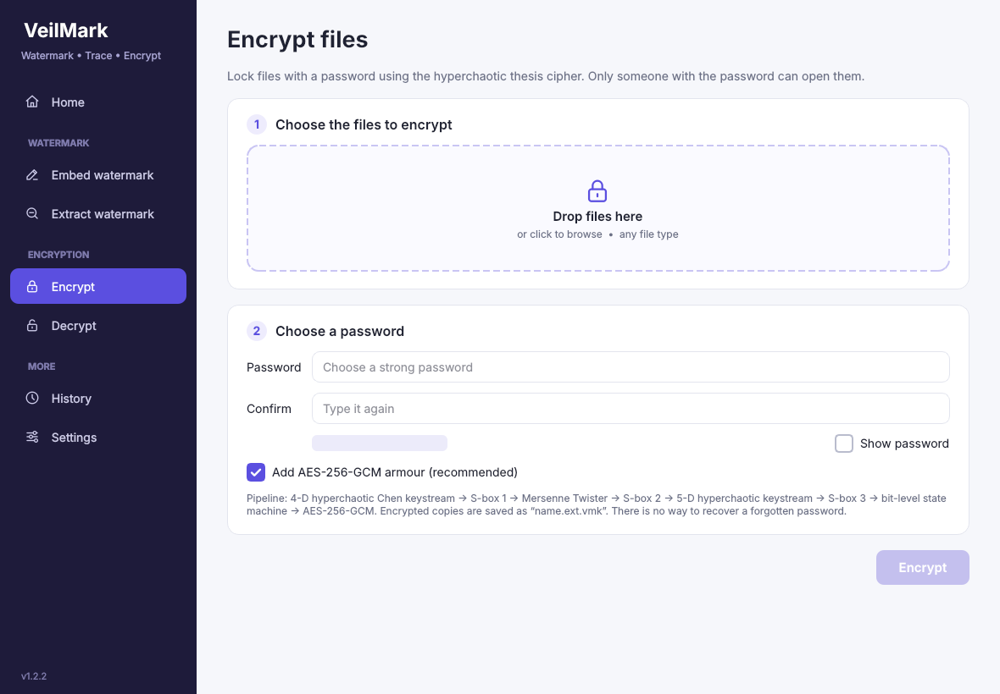

# VeilMark — invisible watermarks, leak tracing & chaotic encryption for Office files

VeilMark is a Windows desktop app that:

1. **Protects** Word, PowerPoint and Excel files (plus PNG/BMP pictures and text files) with invisible,
   encrypted watermarks, giving every recipient a uniquely marked copy.
2. **Traces leaks**: drop a suspicious file (or paste copied text) into the app and it shows who owns the document
   and who the copy was issued to. This works even after the file has been forwarded and re-shared several times.
3. **Encrypts files** with the hyperchaotic cascade cipher from the original master's thesis (4-D Chen system,
   Mersenne Twister, 5-D hyperchaotic system, three S-boxes and the bit-level state machine), with optional
   AES-256-GCM armour on top.

It is a re-engineering of the thesis Mathematica code (`InsertSecretMessage`, `EncImg2`, `DecImg`, `calSeqChen`,
`calc5D`, `enc`/`trans`, the S-boxes `sb1`–`sb3`) for real-world documents.

| Home | Embed a watermark |
|---|---|
|  |  |
| **Extract a watermark** | **Encrypt** |
|  |  |

---

## Getting the Windows app

**Download:** https://github.com/AhmedWalid4499/My-Encryption-app/releases/latest

Direct installer link (always the newest version):
https://github.com/AhmedWalid4499/My-Encryption-app/releases/latest/download/VeilMark-Setup.exe

* `VeilMark-Setup.exe`: a normal Windows installer (no admin rights needed).
* `VeilMark-Portable.zip`: unzip it and run `VeilMark.exe`.
* `SHA256SUMS.txt`: checksums of both files.

Windows SmartScreen may say *"Windows protected your PC"* because the app isn't code-signed yet. Click
**More info**, then **Run anyway**.

### Automatic updates
VeilMark checks GitHub for a newer release when it starts (and every 6 hours while open). If there is one, it
**downloads it in the background**, verifies its SHA-256 checksum, and shows **"✨ Update ready – Click to install"**
in the sidebar. One click closes the app, installs the new version and reopens it. Settings, team key and sharing
history are kept. You can turn this off, or check manually, under **Settings → Updates**.

**Publishing a new version (for the maintainer):** bump `__version__` in `veilmark/__init__.py` (and the version in
`packaging/installer.iss` / `packaging/version_info.txt`; a test checks they match), commit, then push a tag:

```bash
git tag v1.2.0
```

```bash
git push origin v1.2.0
```

GitHub Actions tests the code on Linux and Windows, builds the installer and publishes the release. Every installed
copy picks it up automatically.

**Build it yourself on Windows:** install Python 3.11+ from python.org, then double-click `build_windows.bat`
(it installs dependencies, runs the tests and builds `dist\VeilMark\VeilMark.exe`; if Inno Setup 6 is
installed it also builds the installer).

**Run from source (any OS):**

```bash
pip install -r requirements.txt
python run_veilmark.py
```

---

## Using it

The sidebar has two clear sections: **Watermark** (Embed / Extract) and **Encryption** (Encrypt / Decrypt).

### First run
Open **Settings**, type your name and organisation, and click **Save**. They are recorded as the owner of every
watermark you embed.

### Embed a watermark
1. **Write your watermark**: type the text to hide, e.g. `© 2026 BookBeans – Confidential, do not distribute`.
   Tick *Also show this text visibly as a footer* if you want it printed at the bottom of every page / slide too.
2. **Choose the files**: drag files or folders onto the drop zone, or click to browse.
3. **Options (optional)**: fill in *Copy for* (e.g. `Sara Ahmed`) if you want to trace a leaked copy back to that
   person.
4. Click **Embed watermark**. You get `Report - watermarked.pptx` (or `Report - for Sara Ahmed.pptx`) next to the
   original. The original is never changed.

If you embed a new watermark in a file that already has one, VeilMark keeps the earlier ones in the file's
**watermark history** (e.g. *Owner → Sara → Omar*), so a leaked copy still points at the last person who received
it. Every watermark you embed is also listed in **History**.

The visible footer appears on every page in Word, at the bottom of every slide in PowerPoint, and in the printed
page footer in Excel (shown in Page Layout view and on print). Existing footers are kept. If someone deletes the
visible footer, the invisible watermark is still there.

### Extract a watermark
Drop any file onto **Extract watermark**, or paste text copied from an email, website or chat. You'll see:

* the **watermark text**, in large type (with a *Copy text* button),
* who the copy was for, when it was embedded, and the owner,
* the **watermark history** if the file was watermarked more than once,
* which hidden layers survived.

You can save the result as an HTML report.

### Updates never make VeilMark forget
* Your settings, team key and History live in `%APPDATA%\VeilMark`. The installer never touches that folder, so
  updates keep everything.
* Every team key ever used on your PC is kept in `keyring.json`. If you generate a new key or switch to a
  colleague's key, files watermarked with the old key **still extract** on your PC.
* If the settings file is ever damaged or locked, VeilMark restores it from `settings.backup.json` or the keyring.
  It never silently creates a new key (the damaged file is kept aside as `settings.damaged-….json`).
* Your last watermark text is remembered and pre-filled on the Embed page.
* `tests/fixtures` holds real files made by every released version (1.1.0, 1.2.1, …). Every build must still
  extract and decrypt them, so no update can break old watermarks.

### Working as a team
Watermarks are sealed with your **team key** (Settings → Team watermark key). Give colleagues the same key
(**Copy**, then on their PC **Use a colleague's key…**) so everyone can trace each other's documents. A file
protected with a different key is reported as *"watermark from another team key"*.

### Encrypt
Open **Encrypt**, drop any files, type a password twice and click **Encrypt**. You get `name.ext.vmk` next to each
file. There is no password recovery.

### Decrypt
Open **Decrypt**, drop the `.vmk` files, type the password and click **Decrypt**. The original file comes back with
its original name.

### Command line
`veilmark-cli.exe` (or `python run_veilmark.py …`) is included for batch work:

```bash
veilmark-cli embed "Q3 plan.pptx" "Budget.xlsx" --text "© 2026 BookBeans – Confidential" --to "Sara Ahmed" --footer
```

```bash
veilmark-cli extract "found online.pptx"
```

```bash
veilmark-cli encrypt contract.docx
```

```bash
veilmark-cli decrypt contract.docx.vmk
```

---

## How the watermark survives being shared multiple times

The same mark is hidden in up to five independent places. Losing some of them is fine, because **one surviving
layer is enough** to trace the copy.

| Layer | What is stored | Survives | Lost when |
|---|---|---|---|
| Encrypted document properties | Full record: owner, title, complete chain of custody (AES-256-GCM) | Opening/editing/re-saving in Office or LibreOffice, emailing, cloud upload | *File → Inspect Document → Remove all* |
| Hidden custom XML part | Second copy of the full record | Same as above | *Inspect Document* |
| Invisible text marks (zero-width Unicode) | Authenticated 16-byte token per hop (the whole chain) | All of the above, **plus** Inspect Document, copying slides into another deck, copy & paste of text into emails/chats/other files | The text is retyped, OCR'd, or the marked paragraphs are deleted |
| Picture pixels (LSB, the thesis method) | Token chain + full record, repeated across the picture | Re-saving, copying slides/pictures into other files, cropping (the payload repeats) | The picture is compressed to JPEG, resized or screenshotted |
| Hidden data sheet (Excel) | Full record in a *very hidden* worksheet | Re-saving | *Inspect Document* (hidden worksheets) or manual deletion via VBA |

Optional (off by default): *Also mark Excel cell text* puts invisible marks inside long text cells. It is off
because it changes cell values and could affect formulas that compare text.

The **tokens** are only 16 bytes (`doc_id | copy_id | HMAC`), so they fit anywhere. If only tokens survive, the
local **History** ledger turns the copy ID back into the recipient's name. The HMAC proves the mark was made with
your team key, so nobody can forge a watermark that points at someone else.

### Limits worth knowing
No watermark survives everything. **Printing, screenshots/photos of the screen, and retyping** the content destroy
all invisible marks, and a determined, technical person who knows exactly what to look for can strip them. VeilMark
is a deterrent and a tracing tool, not DRM. Old binary formats (`.doc`, `.ppt`, `.xls`) must be re-saved as
`.docx/.pptx/.xlsx` first.

---

## The encryption (thesis methodology)

```
data ─► XOR k1 (4-D hyperchaotic Chen)  ─► S-box sb1     ┐  = EncImg2[ , k1, sb1]
     ─► XOR k2 (Mersenne Twister)       ─► S-box sb2     │  = EncImg2[ , k2, sb2]
     ─► XOR k3 (5-D hyperchaotic system)─► S-box sb3     ┘  = EncImg2[ , k3, sb3]
     ─► bit-level state machine with keyMT                  = enc[ , keyMT]  (trans / cXnor)
     ─► AES-256-GCM armour (optional, on by default)
```

Changes from the Mathematica version, and why:

* **Keys come from a password.** scrypt plus a random 16-byte salt per file produce the seeds and initial
  conditions of every chaotic system, so the same file encrypted twice gives different output.
* **Fixed-step RK4 instead of `NDSolve`.** Adaptive solvers are not bit-for-bit reproducible across PCs. A fixed
  step in IEEE float64 is, which means a file encrypted on one computer always decrypts on another. Known-answer
  tests check this on Windows CI.
* **Bytes instead of median-thresholded bits**, sampled from many parallel trajectories. The keystream is 8× denser
  and fast enough for real files (about 1.4 s for 5 MB).
* **The `enc` state machine.** Its transitions don't depend on the data, so per byte it equals
  `x ⊕ key ⊕ 0x61` (XNOR at bit positions 2, 3, 8). It is still its own inverse, as in the thesis. A literal
  bit-by-bit port is kept in `cipher.state_machine_byte` and the test suite checks the two match.
* **Integrity.** AES-GCM (or HMAC-SHA256 when the armour is off) detects wrong passwords and tampering.
* The chaotic layers implement the thesis design faithfully, but chaotic ciphers are not a vetted standard. That is
  why the AES-256-GCM armour is on by default.

---

## Project layout

```
veilmark/
  crypto/chaos.py      4-D Chen, 5-D hyperchaotic system, Mersenne Twister keystreams (calSeqChen, calc5D, k2/keyMT)
  crypto/sboxes.py     sb1, sb2, sb3 and CalSboxInv
  crypto/cipher.py     cascade cipher, state machine (enc/trans), .vmk file format
  watermark/lsb.py     InsertSecretMessage / ExtractSecretMessage (framed + repeated)
  watermark/zerowidth.py  invisible-text encoding
  watermark/payload.py tokens, encrypted records, chain of custody
  watermark/ooxml.py   Office Open XML package editing (lxml, keeps Office happy)
  watermark/engine.py  the five layers: embed + trace
  watermark/footer.py  optional visible "Confidential – prepared for …" footer
  updater.py           GitHub Releases update check, verified download, silent install
  registry.py          SQLite sharing history (%APPDATA%\VeilMark\ledger.db)
  settings.py          name, organisation, team key (%APPDATA%\VeilMark\settings.json)
  service.py           protect_file / trace_file used by GUI and CLI
  gui/                 PySide6 (Qt) desktop interface
  cli.py               command line
tests/                 93 tests incl. LibreOffice re-save, Inspect-Document, slide-copy, multi-hop, cross-PC vectors
packaging/             PyInstaller spec, Inno Setup installer script, Windows version info
```

Run the tests:

```bash
pip install -r requirements-dev.txt
```

```bash
python -m pytest -q
```
