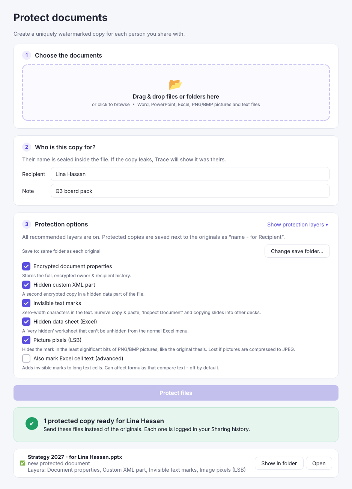
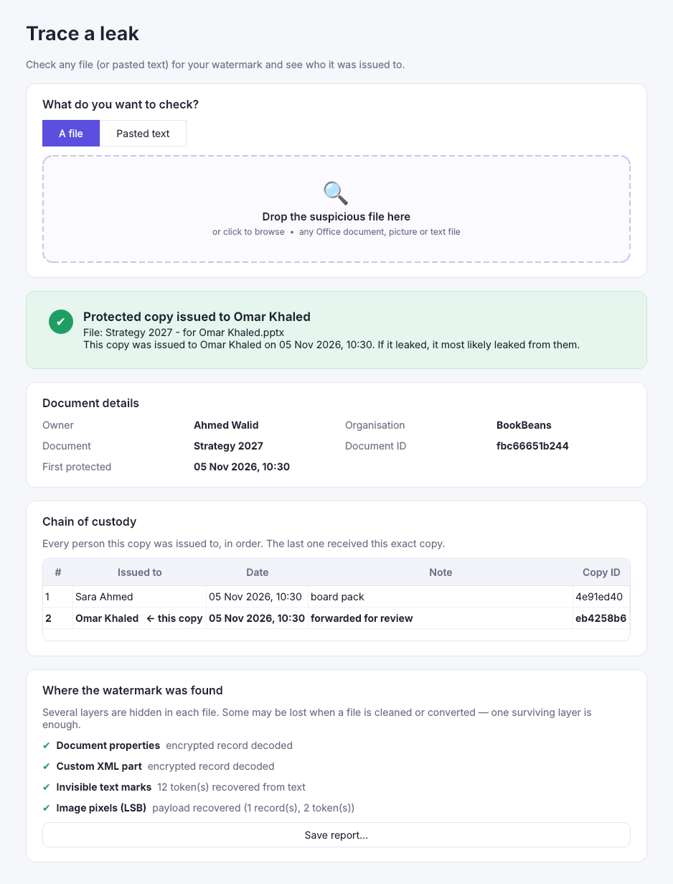

# VeilMark — invisible watermarks, leak tracing & chaotic encryption for Office files

VeilMark is a Windows desktop app that:

1. **Protects** Word, PowerPoint and Excel files (plus PNG/BMP pictures and text files) with invisible,
   encrypted watermarks, giving every recipient a uniquely marked copy.
2. **Traces leaks**: drop a suspicious file (or paste copied text) into the app and it shows who owns the document
   and who the copy was issued to. This works even after the file has been forwarded and re-shared several times.
3. **Encrypts files** with the hyperchaotic cascade cipher from the original master's thesis (4-D Chen system,
   Mersenne Twister, 5-D hyperchaotic system, three S-boxes and the bit-level state machine), with optional
   AES-256-GCM armour on top.

It is a re-engineering of the thesis Mathematica code (`InsertSecretMessage`, `EncImg2`, `DecImg`, `calSeqChen`,
`calc5D`, `enc`/`trans`, the S-boxes `sb1`–`sb3`) for real-world documents.

| Home | Protect |
|---|---|
|  |  |
| **Trace a leak** | **Encrypt** |
|  |  |

---

## Getting the Windows app

**Easiest:** open the repository's **Actions** tab, then the latest *Test & build Windows app* run, and download the
**VeilMark-Windows** artifact. It contains:

* `VeilMark-Setup-1.0.0.exe`: a normal Windows installer (no admin rights needed).
* `VeilMark-Portable.zip`: unzip it and run `VeilMark.exe`.

Pushing a tag such as `v1.0.0` also publishes both files as a GitHub Release.

**Build it yourself on Windows:** install Python 3.11+ from python.org, then double-click `build_windows.bat`
(it installs dependencies, runs the tests and builds `dist\VeilMark\VeilMark.exe`; if Inno Setup 6 is
installed it also builds the installer).

**Run from source (any OS):**

```bash
pip install -r requirements.txt
python run_veilmark.py
```

---

## Using it

### First run
Open **Settings**, type your name and organisation, and click **Save**. They are sealed into every document you
protect as its owner.

### Protect a document
1. Drag files or folders onto the drop zone.
2. Type who the copy is for (e.g. `Sara Ahmed <sara@company.com>`) and an optional note.
3. Click **Protect**. You get `Report - for Sara Ahmed.pptx` next to the original. Send that copy, not the original.

**Re-sharing:** if Sara's copy (or any protected copy) is protected again for someone else, VeilMark detects the
existing watermark and *adds a link to its chain of custody* (Owner → Sara → Omar → …). Every protected copy is
also logged in **History**.

### Trace a leak
Drop the file you found (or switch to **Pasted text** and paste text copied from an email, website or chat). You'll
see:

* the owner, organisation and document ID,
* the **chain of custody**, with the last row marked "this copy". That's the person this exact copy was issued to,
* which hidden layers survived.

You can save the result as an HTML report.

### Working as a team
Watermarks are sealed with your **team key** (Settings → Team watermark key). Give colleagues the same key
(**Copy**, then on their PC **Use a colleague's key…**) so everyone can trace each other's documents. A file
protected with a different key is reported as *"watermark from another team key"*.

### Encrypt / decrypt
Drop any files, choose a password and click **Encrypt**. You get `name.ext.vmk`. Drop a `.vmk` file to switch to
decrypt mode automatically. There is no password recovery.

### Command line
`veilmark-cli.exe` (or `python run_veilmark.py …`) is included for batch work:

```bash
veilmark-cli protect "Q3 plan.pptx" "Budget.xlsx" --to "Sara Ahmed" --note "board pack"
```

```bash
veilmark-cli trace "found online.pptx"
```

```bash
veilmark-cli encrypt contract.docx
```

```bash
veilmark-cli decrypt contract.docx.vmk
```

---

## How the watermark survives being shared multiple times

The same mark is hidden in up to five independent places. Losing some of them is fine, because **one surviving
layer is enough** to trace the copy.

| Layer | What is stored | Survives | Lost when |
|---|---|---|---|
| Encrypted document properties | Full record: owner, title, complete chain of custody (AES-256-GCM) | Opening/editing/re-saving in Office or LibreOffice, emailing, cloud upload | *File → Inspect Document → Remove all* |
| Hidden custom XML part | Second copy of the full record | Same as above | *Inspect Document* |
| Invisible text marks (zero-width Unicode) | Authenticated 16-byte token per hop (the whole chain) | All of the above, **plus** Inspect Document, copying slides into another deck, copy & paste of text into emails/chats/other files | The text is retyped, OCR'd, or the marked paragraphs are deleted |
| Picture pixels (LSB, the thesis method) | Token chain + full record, repeated across the picture | Re-saving, copying slides/pictures into other files, cropping (the payload repeats) | The picture is compressed to JPEG, resized or screenshotted |
| Hidden data sheet (Excel) | Full record in a *very hidden* worksheet | Re-saving | *Inspect Document* (hidden worksheets) or manual deletion via VBA |

Optional (off by default): *Also mark Excel cell text* puts invisible marks inside long text cells. It is off
because it changes cell values and could affect formulas that compare text.

The **tokens** are only 16 bytes (`doc_id | copy_id | HMAC`), so they fit anywhere. If only tokens survive, the
local **History** ledger turns the copy ID back into the recipient's name. The HMAC proves the mark was made with
your team key, so nobody can forge a watermark that points at someone else.

### Limits worth knowing
No watermark survives everything. **Printing, screenshots/photos of the screen, and retyping** the content destroy
all invisible marks, and a determined, technical person who knows exactly what to look for can strip them. VeilMark
is a deterrent and a tracing tool, not DRM. Old binary formats (`.doc`, `.ppt`, `.xls`) must be re-saved as
`.docx/.pptx/.xlsx` first.

---

## The encryption (thesis methodology)

```
data ─► XOR k1 (4-D hyperchaotic Chen)  ─► S-box sb1     ┐  = EncImg2[ , k1, sb1]
     ─► XOR k2 (Mersenne Twister)       ─► S-box sb2     │  = EncImg2[ , k2, sb2]
     ─► XOR k3 (5-D hyperchaotic system)─► S-box sb3     ┘  = EncImg2[ , k3, sb3]
     ─► bit-level state machine with keyMT                  = enc[ , keyMT]  (trans / cXnor)
     ─► AES-256-GCM armour (optional, on by default)
```

Changes from the Mathematica version, and why:

* **Keys come from a password.** scrypt plus a random 16-byte salt per file produce the seeds and initial
  conditions of every chaotic system, so the same file encrypted twice gives different output.
* **Fixed-step RK4 instead of `NDSolve`.** Adaptive solvers are not bit-for-bit reproducible across PCs. A fixed
  step in IEEE float64 is, which means a file encrypted on one computer always decrypts on another. Known-answer
  tests check this on Windows CI.
* **Bytes instead of median-thresholded bits**, sampled from many parallel trajectories. The keystream is 8× denser
  and fast enough for real files (about 1.4 s for 5 MB).
* **The `enc` state machine.** Its transitions don't depend on the data, so per byte it equals
  `x ⊕ key ⊕ 0x61` (XNOR at bit positions 2, 3, 8). It is still its own inverse, as in the thesis. A literal
  bit-by-bit port is kept in `cipher.state_machine_byte` and the test suite checks the two match.
* **Integrity.** AES-GCM (or HMAC-SHA256 when the armour is off) detects wrong passwords and tampering.
* The chaotic layers implement the thesis design faithfully, but chaotic ciphers are not a vetted standard. That is
  why the AES-256-GCM armour is on by default.

---

## Project layout

```
veilmark/
  crypto/chaos.py      4-D Chen, 5-D hyperchaotic system, Mersenne Twister keystreams (calSeqChen, calc5D, k2/keyMT)
  crypto/sboxes.py     sb1, sb2, sb3 and CalSboxInv
  crypto/cipher.py     cascade cipher, state machine (enc/trans), .vmk file format
  watermark/lsb.py     InsertSecretMessage / ExtractSecretMessage (framed + repeated)
  watermark/zerowidth.py  invisible-text encoding
  watermark/payload.py tokens, encrypted records, chain of custody
  watermark/ooxml.py   Office Open XML package editing (lxml, keeps Office happy)
  watermark/engine.py  the five layers: embed + trace
  registry.py          SQLite sharing history (%APPDATA%\VeilMark\ledger.db)
  settings.py          name, organisation, team key (%APPDATA%\VeilMark\settings.json)
  service.py           protect_file / trace_file used by GUI and CLI
  gui/                 PySide6 (Qt) desktop interface
  cli.py               command line
tests/                 43 tests incl. LibreOffice re-save, Inspect-Document, slide-copy, multi-hop, cross-PC vectors
packaging/             PyInstaller spec, Inno Setup installer script, Windows version info
```

Run the tests:

```bash
pip install -r requirements-dev.txt
```

```bash
python -m pytest -q
```
